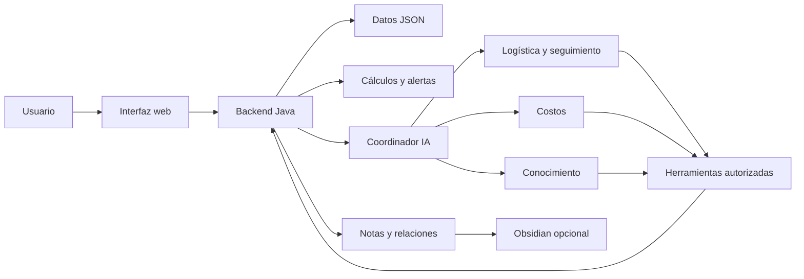

# ObraPlan

**Gestión de adquisiciones para obras de construcción, con agentes de IA y un grafo de conocimiento.**

ObraPlan permite responder qué materiales necesita una obra, cuándo gestionarlos, qué precios se conocen y qué entregas siguen pendientes. Reúne materiales, proveedores, cotizaciones y pedidos en una aplicación web con backend Java 21. Un equipo de agentes con Gemini interpreta los registros y propone prioridades con fuentes.

Proyecto desarrollado por **Luz Dari Crespo Gómez**. El planteamiento, requisitos, decisiones y evidencias están documentados en este repositorio.

## Qué puedes hacer

- Crear una cuenta y administrar tus propias obras.
- Registrar materiales por etapa, cantidad, unidad, fecha necesaria y plazo.
- Añadir ferreterías y registrar sus ofertas manualmente.
- Comparar cotizaciones y llevar estados de pedido, tránsito y recepción.
- Revisar subtotal conocido, precios faltantes y alertas de fechas.
- Seguir una guía para principiantes con ocho secciones y lectura por voz local.
- Consultar agentes de IA y ver participantes, herramientas, fuentes y consumo.
- Conservar propuestas completas en un grafo conectado con Obsidian.

No realiza compras, pagos ni contactos automáticos. Los precios y estados comerciales los registra el usuario. Las cantidades de demostración no constituyen un cálculo estructural.

## Cómo funciona



El software valida y guarda datos y calcula costos con reglas explícitas. Gemini interpreta la pregunta y decide delegaciones y consultas a herramientas. Los cuatro agentes tienen instrucciones, historiales y herramientas diferentes y comparten un modelo configurable. No se ejecuta Gemini al abrir formularios ni al escuchar la guía.

## Ejecutar en tu equipo

Necesitas **JDK 21**, Git y PowerShell en Windows. Python **3.11 o superior** se utiliza para las herramientas documentales; no requiere paquetes externos para el modo base. No hace falta Maven ni una instalación de Node para utilizar la aplicación.

Clona este repositorio, entra en su carpeta y prepara tu configuración local:

```powershell
Copy-Item config/integrations.example.json config/integrations.json
./run.ps1
```

Si ya tienes `config/integrations.json`, conserva tu configuración. Abre **http://127.0.0.1:8080** y detén el servidor con **Ctrl+C**. También puedes iniciar con `run.bat`.

Al iniciar sin base existente se crea un escenario ficticio. Acceso de demostración: **demo@obraplan.co** / **ObraPlan2026!**. Las cuentas nuevas tienen sus propias obras. No reemplaces `data/obraplan.json` para ejecutar pruebas: contiene los registros locales guardados.

## Activar los agentes con Gemini

La aplicación de adquisiciones funciona sin clave. Para consultar los agentes:

1. Obtén tu propia clave en Google AI Studio y revisa cuotas y condiciones de tu proyecto.
2. Ejecuta `./scripts/configure_ai.ps1` y sigue sus indicaciones. Guarda la clave protegida por Windows, fuera de Git.
3. Reinicia con `./run.ps1`.
4. Abre una obra con datos, entra en **Agentes y conocimiento** y pulsa **Consultar agentes**.

El modelo predeterminado del código es `gemini-3.5-flash-lite`; puede configurarse mediante `OBRAPLAN_GEMINI_MODEL` entre los modelos permitidos. La disponibilidad depende de Google y de tu cuenta. Los límites locales acotan consumo; no garantizan gratuidad ni verifican facturación. Más información: [configuración IA](docs/IA_CONFIGURACION.md).

| Agente IA | Responsabilidad |
|---|---|
| Coordinador | Interpreta la pregunta, delega y sintetiza. |
| Logística y seguimiento | Consulta fechas, prioridades, pedidos y alertas. |
| Costos | Consulta cálculos y cotizaciones; explica subtotal y faltantes. |
| Conocimiento | Recupera reglas, requisitos y relaciones que respaldan propuestas. |

Las instrucciones están en `AgentTeam.java`, la conexión en `GeminiClient.java` y las herramientas en `WorkAgentTools.java`. Las clases por reglas de `agents/` ejecutan cálculos; las skills de `.agents/skills/` orientan el desarrollo. Son componentes con funciones distintas.

## Conocimiento y Obsidian

Al guardar registros, `KnowledgeAgent` deriva notas y relaciones. Las propuestas IA se conservan con confirmación explícita. El grafo conecta problema, requisitos, componentes, reglas y registros de obra; recuperar notas no reentrena el modelo.

Para conectar tu vault edita `config/integrations.json` y configura su ruta e intérprete Python. La configuración de ejemplo deja Obsidian desactivado y no incorpora rutas de otros equipos. Conserva los aprendizajes editables separados de las notas generadas.

```powershell
python agents/knowledge_agent.py query "costo sin cotización"
python scripts/build_knowledge.py
python scripts/sync_knowledge.py --vault "C:/ruta/a/tu/vault" --check
python scripts/sync_knowledge.py --vault "C:/ruta/a/tu/vault"
```

## Estructura

```text
src/main/java/co/obraplan/      Servidor, servicio y persistencia
  agents/                     Reglas y conocimiento
    ai/                       Coordinador, modelos y contratos IA
src/main/resources/static/    Interfaz, grafo y guía hablada
src/test/                     Verificaciones Java
agents/                       Herramienta Python de conocimiento
.agents/skills/                Skills de desarrollo del proyecto
docs/                         Problema, requisitos, arquitectura y evidencia
knowledge/                    Catálogo y notas documentales
config/                       Plantilla de integraciones
scripts/                      Compilar, configurar, comprobar y sincronizar
data/                         Base local privada; no publicada
output/                       Notas operativas y reportes; no publicados
```

## Verificación

```powershell
./scripts/verify.ps1
```

Las comprobaciones utilizan bases temporales; no reemplazan adquisiciones del usuario. La evidencia disponible, las pruebas simuladas y las consultas Gemini reales se distinguen en [VERIFICACION.md](docs/VERIFICACION.md). El código conserva indentación mediante `.editorconfig`.

## Documentación

| Documento | Contenido |
|---|---|
| [Problema](docs/PROBLEMA.md) | Origen, actores y objetivos |
| [Requisitos](docs/ANALISIS.md) | Funcionales, no funcionales y aceptación |
| [Arquitectura](docs/ARQUITECTURA.md) | Entidades y responsabilidades |
| [Agentes](docs/AGENTES.md) | Roles, herramientas y skills |
| [Conocimiento](docs/CONOCIMIENTO.md) | Grafo y Obsidian |
| [Mapa operativo](COMO_SE_HACEN_LAS_COSAS.md) | Dónde está cada componente y entorno |
| [Bitácora](docs/BITACORA.md) | Decisiones y evolución |
| [Guía de uso y voz](docs/BIENVENIDA_VOZ.md) | Recorrido para principiantes |
| [Guion de presentación](docs/GUIA_VIDEO.md) | Explicación y demostración |
| [Publicación y despliegue](docs/PUBLICACION.md) | GitHub, Vercel y persistencia |

## Estado del despliegue

La versión comprobada se ejecuta localmente. **Todavía no hay una URL pública verificada.** Subir el código a GitHub no pone automáticamente en funcionamiento el backend.

Vercel dispone de un runtime de contenedores en beta que puede ejecutar Java, pero esta aplicación necesita adaptar escucha/puerto, persistencia JSON y sesiones antes de anunciar una demo completa y estable. Las opciones y límites están en [PUBLICACION.md](docs/PUBLICACION.md). Cuando exista un despliegue comprobado, su URL puede añadirse al README y al campo Website del repositorio.

Las claves, base de usuarios, sesiones, respaldos y configuración personal están excluidos de Git. El servicio local escucha en loopback; esta versión no se presenta como servicio público de producción.
