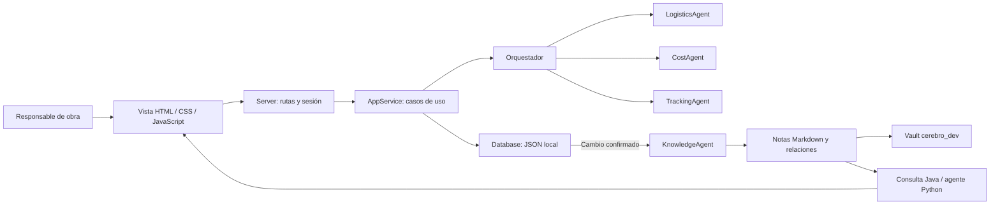

# Estructura y componentes de ObraPlan

## Recorrido del sistema

## Qué representa cada entidad

| Entidad | Qué representa | Relación principal |
|---|---|---|
| Usuario | Responsable con acceso local | Es propietario de obras |
| Obra | Proyecto de construcción con ubicación y etapa | Contiene materiales, proveedores y cotizaciones |
| Material | Necesidad: cantidad, unidad, etapa y fecha | Pertenece a una obra; recibe cotizaciones |
| Ferretería | Contacto de un proveedor | Pertenece al directorio de una obra; ofrece cotizaciones |
| Cotización | Precio/plazo comunicado para un material | Vincula material y ferretería de la misma obra |
| Actividad | Evento de la bitácora operativa | Registra un cambio en una obra |
| Nota de conocimiento | Problema, requisito, regla, agente o registro | Se conecta mediante enlaces `[[OP-...]]` |

Estas entidades se almacenan como objetos JSON. Las clases Java actuales representan servicios y especialistas, no una clase de dominio por cada entidad. Esa decisión es visible para no confundir el diagrama conceptual con el código.

## Clases y responsabilidades

| Clase / archivo | Responsabilidad | Entradas → salidas |
|---|---|---|
| `Server.java` | Entrada HTTP, rutas, cookies y recursos web | Solicitud → JSON / HTML |
| `AppService.java` | Casos de uso, autorización por obra y validación | Usuario + datos → operación |
| `Database.java` | Lectura, escritura atómica y notificación después de guardar | Estado válido → JSON persistido |
| `Json.java` | Conversión JSON sin dependencia externa | Texto ↔ objetos Java |
| `Password.java` | Hash y verificación de contraseña | Contraseña → hash / verificación |
| `HttpError.java` | Error de aplicación con estado HTTP | Error de regla → respuesta |
| `agents/Orchestrator.java` | Coordinación de especialistas | Materiales + cotizaciones → informe |
| `agents/LogisticsAgent.java` | Fecha necesaria menos plazo | Material → alerta |
| `agents/CostAgent.java` | Cotizaciones válidas y costo conocido | Materiales + precios → estimación |
| `agents/TrackingAgent.java` | Pedidos en curso con entrega estimada vencida | Cotización → aviso de revisión |
| `agents/KnowledgeAgent.java` | Publicación automática, consulta y relaciones | Estado confirmado + notas → grafo |
| `agents/Insight.java` | Resultado de especialista con fuente | Agente + detalle + material + nota |
| `agents/AgentData.java` | Conversiones comunes | Datos → fecha / número / texto |

## Integración con conocimiento

Las reglas de costos/logística/seguimiento se ejecutan en Java; las notas explican su fundamento. El agente de conocimiento consulta contenido documental y devuelve fuentes y relaciones. No reprograma reglas al leer una nota. Cambiar una regla requiere cambiar el código y su requisito, comprobarlo y actualizar la bitácora.

La base notifica cambios solo después de persistir. El agente publica notas de obra, materiales, ferreterías y cotizaciones, conectadas por IDs estables. Los datos originales permanecen en `data/obraplan.json`. Las notas generadas son una proyección del estado; los conocimientos redactados por el usuario van en `Aprendizajes/`, evitando que la generación los sobrescriba.

La vista HTTP incluye las notas generales y los registros de la obra autorizada. El vault es un espacio local al que su propietario puede acceder directamente. No se exportan hashes, sesiones, correos de usuarios ni teléfonos/direcciones de proveedores. No hay proceso de consulta automática de precios o envío a servicios externos.

## Entornos independientes

El sistema web usa JDK 21. El agente de conocimiento Python usa biblioteca estándar, con proyecto propio en `pyproject.toml` y `uv.lock`. El adaptador ejecuta agentes externos mediante un subproceso: intérprete explícito, carpeta de trabajo del agente y JSON por entrada/salida. Así no se importan bibliotecas de un entorno en otro. El registro de integración debe contener rutas existentes y un contrato compatible antes de habilitarlo.

## Límites de esta arquitectura

Es una entrega local con JSON y sesiones en memoria. La capa de coordinación IA necesita una clave y una consulta real para comprobar la conexión; no se afirma escalabilidad de producción ni aprobación del profesor. Un fallo al publicar notas se informa en la vista y permite reintentar; no se pierde la operación ya guardada. La sincronización es una proyección del estado actual, no una copia de seguridad de la base.
# Capa de agentes de IA incorporada el 8 de octubre de 2026

Interfaz `assistant.js` → Server autenticado → WorkAgentTools por propietario/obra → AgentTeam → GeminiClient REST. El coordinador y los tres especialistas tienen historiales independientes y herramientas diferentes. Gemini decide la delegación y las consultas; Java ejecuta herramientas autorizadas y devuelve observaciones al modelo. Los cálculos existentes siguen siendo deterministas.

La IA no escribe adquisiciones. Una confirmación explícita conserva una propuesta completa en KnowledgeAgent, con vínculos al coordinador, obra y fuentes. La recuperación incluye únicamente los análisis de la obra solicitada. Configuración, consumo y estado real en `IA_CONFIGURACION.md`.
